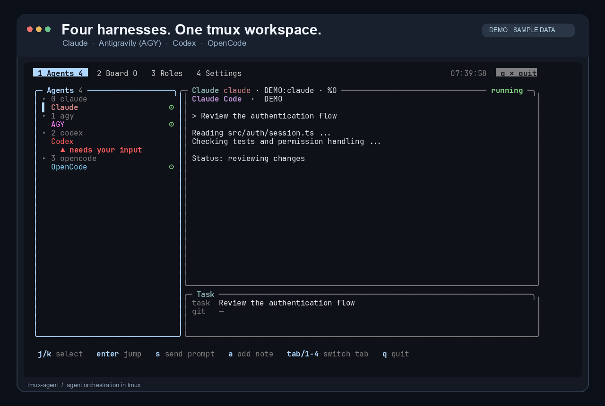

<h1 align="center">tmux-agent</h1>

<p align="center"><strong>A tmux-based coding agent.</strong></p>

<p align="center">
  <a href="LICENSE"></a>
  <a href="go.mod"></a>
</p>

tmux-agent brings Claude Code, Antigravity (AGY), Codex, OpenCode, Pi, Gemini, Copilot, Amp and other coding agents into one workspace. See what each agent is doing, find the ones waiting for you, and coordinate work across panes and projects.

## Demo



*The demo uses simulated agent sessions and sample project data.*

[Install](#install) · [Get started](#get-started) · [Features](#features) · [Commands](#cli) · [Configuration](#configuration)

## One view for the whole team

**Watch the work.** A sidebar follows your tmux windows and shows each agent's status, harness color, elapsed time, and requests that need attention. Expand it into a dashboard to inspect the selected pane without losing your place.

**Coordinate across agents.** Send or queue prompts, share project notes, start agents defined by each repo, and assign work on a task board. The CLI is available to you and to agents with the corresponding integration installed.

**Keep control.** Review approval requests in the sidebar, inspect worktree changes before merging, and use checkpoints to return to earlier work. Notifications and the optional mascot help surface events without replacing your decisions.

## Features

| | What you can do |
|---|---|
| **Sidebar and dashboard** | Track agents by window, inspect live panes, and jump to an agent that needs you. |
| **Harness support** | Integrate Claude Code, Codex, Pi and OpenCode; detect supported agents without hooks through screen scraping. |
| **Team workflow** | Move tickets through role-owned statuses, hand off with comments, and run automatic CI checks. |
| **Worktrees and checkpoints** | Isolate changes, compare results, inspect diffs, merge work and restore snapshots. |
| **Customizable UI** | Choose a theme, colors, keybindings, mascot and optional language model through Settings. |

## Get started

After [installing](#install), open tmux and start a supported agent. The sidebar shows detected agents in your windows. Use the tmux prefix followed by **`e`** to toggle the sidebar and **`A`** to open the dashboard.

```sh
tmux-agent list                         # see your agents
tmux-agent ctx add "API contract: …"   # share a project note
tmux-agent new --name tester --role tester
tmux-agent send tester --wait "Run the tests and report failures"
```

See the [keybindings](#keys) and [CLI reference](#cli) for the full workflow.

## Install

```sh
curl -fsSL https://raw.githubusercontent.com/minhnhat97kg/tmux-agent/main/install.sh | bash
```

The script clones into `~/.local/share/tmux-agent` → builds → links
`~/.local/bin/tmux-agent` → adds one `run-shell` line to `~/.tmux.conf` (only
once) → loads it into the running tmux → runs `tmux-agent install` for every
harness it finds. Run it again to **update**.

Requirements: tmux ≥ 2.9, git, Go (the version in `go.mod`).

Options (environment variables): `TMUX_AGENT_DIR` (clone location),
`TMUX_AGENT_BIN_DIR` (where the binary is linked), `TMUX_AGENT_REF`
(branch/tag), `TMUX_AGENT_NO_TMUX=1` (don't touch tmux.conf),
`TMUX_AGENT_NO_HARNESS=1` (don't install hooks/skills).

<details>
<summary>Manual install</summary>

```sh
git clone <repo> ~/.local/share/tmux-agent && cd ~/.local/share/tmux-agent
make build && ln -s "$PWD/bin/tmux-agent" ~/.local/bin/tmux-agent
echo "run-shell '$PWD/assets/tmux-agent.tmux'" >> ~/.tmux.conf
tmux source ~/.tmux.conf
tmux-agent install
```
</details>

### Harness integration

```sh
tmux-agent install --list          # support matrix + which harnesses are on this machine
tmux-agent install                 # every harness found
tmux-agent install claude pi       # specific ones
tmux-agent install --dry-run       # show what would be written
tmux-agent uninstall <harness>     # remove exactly what install wrote
```

| Harness | Exact status | Agent learns the CLI from |
|---|---|---|
| claude | hooks → `~/.claude/settings.json` | skill |
| codex | hooks → `~/.codex/hooks.json` | skill |
| pi | extension → `~/.pi/agent/extensions/tmux-agent.ts` | skill |
| opencode | plugin → `~/.config/opencode/plugins/tmux-agent.js` | block in `AGENTS.md` |
| gemini · copilot · amp | screen detection (scraper) | block in its instructions file |

Hooks are **merged** into the config (nothing else is overwritten; the
original is kept as `*.tmux-agent.bak`); re-running doesn't duplicate them.
Agents without hooks (Cursor, Aider…) are still detected from the screen.

To let agents use the CLI (post to the board, start helpers) without asking
you each time, allow it in the harness — for Claude, in
`~/.claude/settings.json`: `"permissions": { "allow": ["Bash(tmux-agent:*)"] }`.

## Usage

### Keys

| Key | Where | Does |
|---|---|---|
| `prefix + e` / `E` | tmux | toggle the sidebar in this window / all windows |
| `prefix + A` | tmux | expand / collapse the sidebar into the dashboard (zoom, layout untouched) |
| `prefix + a` | tmux | quick action: go to the agent that needs you / send `@agent_done_prompt` to one that finished |
| `space` · click avatar | sidebar | same as `prefix + a` |
| `j` `k` · mouse | sidebar | move (wheel, click a row) |
| `enter` | sidebar | jump to the pane |
| `1` `2` `3` · `y` `n` | sidebar | answer the prompt of the selected waiting agent |
| `o` | sidebar / zoomed dashboard | zoom / unzoom the same view, keeping selection |
| `,` | sidebar / dashboard | open settings |
| `/` `r` `p` `v` `x` | sidebar | filter · repo filter · pin · select · delete worktree |
| `tab` | sidebar / dashboard | cycle agents, definitions, tasks, and inline Chat |
| `j` `k` | focused list | select an agent or task; selected task details stay visible |
| `n` | Tasks / board | intake; draft `w` changes workflow |
| `s` / `x` | focused task | workflow start picker / confirm task deletion |
| `[` `]` | sidebar / dashboard | change chart range: 24 hours, 7 days, 30 days |

The sidebar and zoomed dashboard use one view and one process. Narrow panes
stack analytics, agents, tasks, and detail. Wide panes place agents and tasks
side by side, with session history below.

### CLI

Run `tmux-agent help` to see the commands and the agents defined in the current repo.

| Command | Does |
|---|---|
| `tmux-agent new --repo-agent <name> [--name <pane-name>] [--agent claude\|codex\|opencode] [--model model] [--worktree]` | Start a repo agent defined in the selected harness's native format; harness/model are chosen by tmux-agent config or flags |
| `tmux-agent agents [<name>]` | List repo agent definitions or print one; `roles` remains an alias |
| `tmux-agent answer <pane> <1\|2\|…\|y\|n\|?>` | Answer an agent's approval prompt (also right in the sidebar) |
| `tmux-agent diff <name> [--stat]` · `merge <name> [--discard]` · `discard <name>` | Review / merge / drop the changes of an agent running in a worktree |
| `tmux-agent fanout -n 3 [--role r] [--wait] "<prompt>"` · `compare <prefix>` | Best-of-N: the same task to N agents in N worktrees, compare, keep the best |
| `tmux-agent task [ls]` · `task add --to <name> "<text>"` · `task start <id> <pane>` · `task set <id> <todo\|doing\|blocked\|done>` · `task assign <id> <name[,name]>` · `task rm <id>` | Create, dispatch, and track tasks on the repo board |
| `tmux-agent stats [ls\|clear]` | Show or delete local Claude, Codex, OpenCode and Pi usage history |
| `tmux-agent save` · `restore [--dry-run]` | Save / bring back your agents after a restart (Claude resumes its session); auto-saved every 30s |
| `tmux-agent tokens` | Tokens used per Claude agent + total |
| `tmux-agent config [list\|get\|set\|reset\|path]` | Central configuration; no arguments = the settings screen (also `,` in the sidebar, or the Settings tab in the dashboard) |
| `tmux-agent list [--json]` | pane · name · agent · status · window · cwd |
| `tmux-agent name [<pane>] <name>` | Name an agent; the name works instead of a pane id everywhere |
| `tmux-agent send <pane> [--now] [--wait] [--timeout D] [--report FILE] <prompt>` | Type a prompt + Enter. A busy agent (working, or waiting on you) gets it **queued** and delivered when idle; `--now` types right away |
| `tmux-agent report wait <file> [--timeout D]` · `report show <file>` | Wait (file events, no polling) for a worker's JSON report and print a one-line summary; `send --report` asks the worker to write it |
| `tmux-agent ask [--role r] [--wait] "<task>"` | Give a task to an idle agent of this repo (with that role), or start a new one if nobody is free |
| `tmux-agent queue [pane]` · `queue clear <pane>` | Show / drop queued messages |
| `tmux-agent checkpoints <agent>` · `undo <agent> [n]` | Every turn starts with a snapshot of the repo; `undo` rolls the files (and the branch, if the agent committed) back to before the last turn — or n turns back. `undo <agent> --redo <ref>` undoes the undo |
| `tmux-agent wait <pane> [--until stopped\|idle\|waiting] [--timeout D]` | Wait for a status (exit 124 on timeout) |
| `tmux-agent read <pane> [-n 50]` | Last N lines of the screen |
| `tmux-agent events [--json]` | Stream status changes / tool calls (one event per line) |
| `tmux-agent next` | The avatar's quick action (most urgent agent: waiting → error → just finished) |
| `tmux-agent kill <pane…>` | Close agent panes (refuses non-agent panes) |
| `tmux-agent ctx [--global] [ls] \| add <text> \| rm <id> \| clear [--mine] \| scope` | Shared context |
| `tmux-agent reload` | After a rebuild: restart the sidebars + scraper |
| `tmux-agent explain <pane>` | Why a pane has its status: hook vs screen, matched rule, CPU/tool evidence |
| `tmux-agent install` / `uninstall` | Harness integration (see above) |

An orchestration example (agents can do this themselves through the skill):

```sh
tmux-agent name lead
tmux-agent ctx add "API contract: …"            # every agent of this repo can read it
tmux-agent new --name tester --role tester
tmux-agent send tester "Run the tests and fix failures"
```

For non-blocking monitoring of one agent, run `tmux-agent wait tester --timeout
30m` once using your harness's background command tool, if it delivers command
completion notifications to the conversation. Use `list --json`, `queue
tester`, and `read tester -n 80` to verify the result: `wait` observes pane
status rather than a particular task. For several agents, `events --json` can
provide a continuous stream if the harness delivers streaming output. It
samples once per second, starts silently, and does not replay events. A
background process alone cannot wake an agent after a chat turn ends; without
harness notifications, check status when the user asks.

### Approvals, warnings, notifications

- **Approval inbox:** an agent waiting for approval shows its question and
  options right under it in the sidebar; put the cursor on it and press
  `1`/`2`/`3` (or `y`/`n`) to answer without jumping to its pane.
- **File conflicts:** two agents of the same project editing the same file
  within 10 minutes → a warning in the list and from the avatar, a note on the
  shared context, and a notification.
- **Stuck agents:** a `running` agent with no activity for
  `@agent_stuck_minutes` minutes (default 10) → a warning.
- **Undo a turn:** before each agent turn the repo's files are snapshotted
  (`@agent_checkpoints`, on by default; a throwaway index and refs under
  `refs/tmux-agent/` — your index, branch and files aren't touched).
  `tmux-agent undo <agent>` puts things back as they were before its last turn.
- **Phone:** `tmux-agent config set notify_url https://ntfy.sh/<topic>` (or a
  Telegram bot `sendMessage` URL) to get a phone message when an agent needs
  approval and when a ticket reaches `done` or `blocked` (with assignees).
  Intermediate workflow steps and finished agent turns stay on the desktop.

Press `?` in the sidebar or dashboard for contextual help. In Chat, `?` is literal input: Tab away first to open help. Focus Chat with Tab or a click, Enter to send, and Esc to close. Ask “which agents are running?” for a read-only answer, describe new work to clarify/draft a ticket, or use `!reload` / `!show ticket abc` to propose an operation. Commands and ticket creation require explicit approval. After an answer, type and Enter to start a fresh request (no conversation history). Context is the latest local ticket/agent/workflow snapshot, not an authoritative historical search; unavailable data is reported rather than guessed. Architectural judgement is escalated to the lead.

### Tickets and status handoffs

The ticket is the workflow: `.tasks/board.yaml` defines ordered statuses and
optional roles. Entering a role-owned status dispatches its agent; returning to
that status reuses the same role/task pane and context. Comments carry handoffs.

```sh
tmux-agent board init
tmux-agent board validate # read-only check of effective config
tmux-agent task add "Implement the feature"  # prints ID
tmux-agent task move ID plan "Requirements and acceptance criteria"
# Worker reads the entire ticket, then hands it on:
tmux-agent task show ID
# Inspect dispatch errors, repair the cause, then explicitly retry current work:
tmux-agent task retry ID
tmux-agent task move ID build "Plan and verification strategy"
```

`run:` statuses execute shell checks asynchronously and comment as `ci`, then
move to their pass/fail status. `max_loops` stops repeated entries at `blocked`, counting since the last exit from blocked.

Agent roles refresh their pane on entry 3 by default (entries 1–2 reuse, 3 replaces,
4 reuses, 5 replaces). Set `fresh_after` on a board status to override its role
setting, or on a role to override the default 3. Explicit `0` disables refresh;
negative values are invalid. Counts are per pane and ticket across all statuses
using the same logical role, including workflow statuses matched by ID. Mentions
and shell jobs do not count. Replacement loses agent context, comment cursor, and
queued prompts, but keeps the worktree and artifacts. `fresh_after: 1` replaces
on every subsequent entry; this is independent of `max_loops`.

Blocked rows show the blocking question. Press `c` to reply in the existing editor,
prefilled with the interrupted role, or run `tmux-agent task comment ID "@implementer answer"`.
The tagged role resumes in the ticket's own flow with only that reply; another role
routes to its first status. Unknown or multiple distinct tags save the comment but
leave the ticket blocked with a notice. With missing history or a roleless step,
type the role explicitly. Agents must block with exactly one concrete question.
`task set` and `task done` remain admin overrides. Assignees and `needs` are
informational, not dispatch gates; mention triggers still notify agents.
Recipes support `workflow new|list|run`, `workflow run NAME --input key=value --wait`,
and `task move ID NEXT --output key=value "Handoff"`.
`task show ID --brief` includes the latest dispatch outcome. Accepted is not
completed; an uncertain reservation may already have sent work, so retry can
duplicate side effects. Retry preserves hourly limits and workflow loop caps.
See the
[Workflows guide](docs/board.md#workflows) for trusted inputs, outputs and live resolution.

See [docs/board.md](docs/board.md) for schema, migration and delivery guarantees.

### Central configuration

`,` in the sidebar opens the settings popup (also `tmux-agent config`): theme,
avatar, sidebar position/width, default agent/model, stuck threshold and
notifications. Changes apply at once and are saved to
`~/.config/tmux-agent/config.conf` (tmux syntax, loaded by the plugin at
startup). Less common options (avatar LLM/personality, key bindings…) are
not in the screen: `tmux-agent config list` shows all of them, and
`tmux-agent config set <key> <value>` changes any — short names work
(`avatar`, `width`, `notify_url`…).

### Repo agents and task board

Define agents using the selected harness's own files: `.claude/agents/<name>.md`, `.codex/agents/<name>.toml`, or `.opencode/agents/<name>.md`. `tmux-agent agents`, the sidebar below running panes, and the dashboard's left pane read those definitions from the repo. The Repo agents tab shows each native file and can open it in `$EDITOR`. Claude and OpenCode launch with their native `--agent` option. Codex does not expose a standalone agent selector, so tmux-agent passes the TOML `developer_instructions` to a new Codex session.

Choose how they run in tmux-agent configuration:

```sh
tmux-agent config set default_agent codex
tmux-agent config set model o3
tmux-agent new --repo-agent reviewer
# or override one launch:
tmux-agent new --repo-agent reviewer --agent claude --model sonnet
```

The task list and agent list remain visible in both widths. Press `tab` to focus tasks, then `j`/`k` to choose one; detail appears below. Press `s` to send it to the agent selected in the other list, or `x` to confirm deletion. A task is marked done only when an agent or user explicitly sets it. The board is shared by all worktrees of the same git repo. Create and update tasks from the CLI:

```sh
tmux-agent task add --to reviewer "Review the auth change"
tmux-agent task ls
tmux-agent task start <id> <pane>
tmux-agent task set <id> doing
tmux-agent task set <id> blocked
tmux-agent task set <id> done
tmux-agent task assign <id> reviewer,tester
tmux-agent task rm <id>
tmux-agent stats ls
tmux-agent stats clear  # deletes local session and task-usage history
```

Pi stats sum assistant token usage across all session branches from
`~/.pi/agent/sessions` (or `$PI_CODING_AGENT_DIR/sessions`), including cache tokens.


### Statuses

| | Meaning |
|---|---|
| running | working |
| waiting | needs you (approval, a question, folder trust…) |
| background | the agent stopped but a background shell still runs |
| done | finished while you weren't looking at its pane — turns idle once you visit it |
| idle / error | idle / failed |

### Avatar

The top of the sidebar holds a small pixel character (drawn with braille:
28×16 pixels in 14 columns × 4 lines) that watches every agent and nudges you
like a friend:

> ▲ Hey, reviewer is done and everything passes — send it the commit prompt?

| Character (`@agent_avatar`) | |
|---|---|
| `slime` (default) | breathes asleep, bounces at work, jumps and squashes when happy, shakes when it needs you, melts when sad |
| `cat` | ear twitches, blinks, `^` eyes when happy, ears up when alarmed, down when sad |
| `sprout` | grows while working, blooms when done, waves its leaves when it needs you, wilts on errors |
| `ghost` | floats, rippling hem |
| `robot` | blinking antenna light, "talking" mouth while working |
| `off` | hidden |

**Its lines** are written by `claude -p --model haiku` (one short, friendly
sentence offering help — never a dump of the session), cached and shared by
every sidebar so one event costs one call; while it answers (a few seconds),
or with the LLM off, a built-in line in the same tone is shown. The default
language is English (`@agent_avatar_lang en`); set `vi` for Vietnamese. Panes
too short for the full avatar get a compact one.

**Quick action** (`space`, a click on the avatar, or `prefix + a` from
anywhere): a waiting or failed agent → jump to its pane (approvals are always
your call); a finished agent → send `@agent_done_prompt` if set, else jump to
it.

```tmux
set -g @agent_avatar sprout
set -g @agent_avatar_lang en                   # vi | en
set -g @agent_digest_llm "ollama run --nowordwrap --think=false qwen3:0.6b"   # writes the avatar's line on every agent event; prompt = last argument
set -g @agent_avatar_lines 6                   # text lines in the speech bubble (1–8, default 1)
set -g @agent_done_prompt "commit and summarize what you did"
set -g @agent_avatar_say_done "{name} is done!"      # your own line (overrides the LLM)
```

### Status line

```tmux
set -ga window-status-format         ' #{E:@agent_status_format}'
set -ga window-status-current-format ' #{E:@agent_status_format}'
set -ga status-right '#{E:@agent_session_status_format}'
set -ga status-right '#{E:@agent_hidden_status_format}'   # standalone agents
```

**Standalone:** `tmux-agent new` outside tmux (a plain terminal) starts the agent
in a detached background session, `tmux-agent-bg`, instead of failing. The
last status-line format lists those agents (name + status icon); attach with
`tmux attach -t tmux-agent-bg`.

Plain `tmux-agent` outside tmux opens a split screen: the dashboard on the
left, the live screen of the selected agent on the right. `Enter` (or a click)
types into that agent (cursor, F-keys, ctrl/alt combos and — when the agent enables mouse reporting — mouse events are passed through), `ctrl+]` returns to the list, `N` starts a new agent in
the current directory. Panes of the background session are resized to fit; your
own tmux sessions are only viewed, never resized.

## Configuration

Set options with `set -g …` before loading the plugin, or use `tmux-agent config`.

| Option | Default | |
|---|---|---|
| `@sidebar_width` | `15%` | sidebar width (columns or %) |
| `@sidebar_position` | `left` | `left` / `right` |
| `@sidebar_auto_create` | `on` | create the sidebar in new windows |
| `@sidebar_key` / `@sidebar_key_all` | `e` / `E` | toggle keys |
| `@agent_watch_key` | `A` | dashboard key |
| `@agent_action_key` | `a` | quick action key |
| `@agent_digest_llm` | `ollama run --nowordwrap --think=false qwen3:0.6b` | command writing the avatar's line on every agent event — who needs you, who works on what (prompt = last argument); a small local model is enough |
| `@agent_avatar` | `slime` | `slime` / `cat` / `sprout` / `ghost` / `robot` / `off` |
| `@agent_avatar_lang` | `en` | `vi` / `en` |
| `@agent_avatar_lines` | `1` | text lines in the speech bubble (1–8) |
| `@agent_avatar_personality` | `cheerful, cute and encouraging` | how the avatar talks — pick a preset (tsundere, lazy office cat, sarcastic, pirate…) or describe your own |
| `@agent_avatar_llm` | `claude -p --model haiku` | command writing the dashboard's task summaries; `off` = none |
| `@agent_done_prompt` | — | prompt the quick action sends to a finished agent |
| `@agent_avatar_say_waiting` / `_done` / `_error` | | your own lines; `{name}`, `{action}` (tmux.conf only, not in the settings screen) |
| `@agent_max_panes` | `4` | max agents per `agents` window |
| `@agent-sidebar-default-agent` | `claude` | default harness for `new` |
| `@agent_model` | — | model passed to the harness as `--model` |
| `@agent_scrape` | `on` | screen detection for agents without hooks |
| `@agent_checkpoints` | `on` | snapshot the repo before each agent turn (for `undo`) |
| `@agent_stuck_minutes` | `10` | warn when a running agent shows no activity this long |
| `@sidebar_notifications` | `on` | desktop notifications |
| `@agent_notify_url` | — | phone alerts and task-status transitions (ntfy or Telegram `sendMessage` URL); Telegram also shares dashboard Chat's project receptionist (approval is local in Chat; `/no` cancels; see [Telegram chat](docs/board.md#telegram-receptionist-chat)) |
| `@agent_theme` | `light` | `dark` / `light`; `@agent_color_<token>`, `@agent_icon_<token>` override single colors/icons |

## Development

```sh
make build && tmux-agent reload   # build + reload the running sidebars/scraper
make test
make update-frames                # re-capture the sidebar's golden frames (check them by eye first)
```

tmux ≥ 2.9 is required because the query layer uses `#{q:…}` to escape `|` in
user data; verified on tmux 3.7b.

## Origin

The architecture and part of the assets derive from
[hiroppy/tmux-agent-sidebar](https://github.com/hiroppy/tmux-agent-sidebar) —
see [NOTICE](./NOTICE). The orchestration ideas come from
[herdr](https://herdr.dev).

## Contributing

Contributions, bug reports and feature requests are welcome. Please open an [issue](https://github.com/minhnhat97kg/tmux-agent/issues) or a pull request.

## License

This project is licensed under the [MIT License](LICENSE). See [NOTICE](NOTICE) for attribution.

---

README structure adapted from [readme-md-generator](https://github.com/kefranabg/readme-md-generator).

Tasks panel and board share ticket controls: `n` intake, `s` workflow start picker,
`enter` detail, `e` edit, `C` comment, `H`/`L` status, `x` delete with confirmation,
`w` workflow, `?` help. Dashboard `Tab` changes focus; `b` opens the board.
